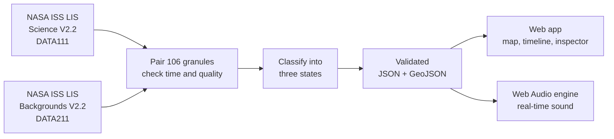

<!--
=====================================================================
 TEAM CHECKLIST: things to fill in before you push (delete this block after)
 1. Team section: replace each "your-handle" with the real GitHub username.
 2. Video section: replace YOUR_VIDEO_ID (2 places) with the YouTube video ID.
    Example: for https://www.youtube.com/watch?v=abc123XYZ the ID is abc123XYZ
 3. Screenshots: save 9 images into docs/screenshots/ using the exact file names below.
 4. Clone section: replace <your-username>/<your-repo> with your real repository path.
 5. License section: add a LICENSE file, then name the license.
=====================================================================
-->

<div align="center">

<h1>SonifyEarth</h1>
<h3>Silence Isn't Zero.</h3>
<p><em>An Observation-Aware Lightning Jukebox</em></p>

<p>
  
  
</p>

<p>
  <a href="#nasa-data-and-credits"></a>
  <a href="#automated-verification"></a>
  <a href="#run-it-in-two-minutes"></a>
  
  
  <a href="07_PROJECT_REPORTS/validation/CONTENT_PRESERVATION_AUDIT.md"></a>
</p>

<p>
  <a href="#meet-the-team"><b>Team</b></a> ·
  <a href="#project-video"><b>Video</b></a> ·
  <a href="#screenshots"><b>Screenshots</b></a> ·
  <a href="#the-idea"><b>The Idea</b></a> ·
  <a href="#features"><b>Features</b></a> ·
  <a href="#run-it-in-two-minutes"><b>Run It</b></a> ·
  <a href="#how-it-works"><b>How It Works</b></a> ·
  <a href="#documentation"><b>Docs</b></a>
</p>

</div>

> **When a lightning map is quiet, what does that silence actually mean?**
> SonifyEarth turns real NASA ISS Lightning Imaging Sensor data into something you can explore, see and **hear**, and it never treats "we didn't look" as "nothing happened."

---

<a id="meet-the-team"></a>
## Meet the Team

We are a five-member team that built SonifyEarth for the **NASA Space Apps Challenge 2026**. One of us led the research, one built the data engine and backend, one designed and built the interface, one made the film and graphics, and one shaped the story. Together we turned one week of NASA lightning observations into an experience that anyone can see, hear and verify.

| | Member | Role |
|:-:|---|---|
| 🧭 | **MD Ibrahim Hossain Ridoy** · [@your-handle](https://github.com/your-handle) | Researcher & Team Leader |
| ⚙️ | **Md. Sulyman Hossain Rifat** · [@your-handle](https://github.com/your-handle) | Backend Developer & Data Analyst |
| 🎨 | **Tahmid Ullah Sajid** · [@your-handle](https://github.com/your-handle) | UI/UX Designer & Frontend Developer |
| 🎬 | **MD Rahedul Islam** · [@your-handle](https://github.com/your-handle) | Video Editor & Graphics Designer |
| ✍️ | **Ta-seen Raihan** · [@your-handle](https://github.com/your-handle) | Script Writer & Storyteller |

---

<a id="project-video"></a>
## Project Video

<div align="center">

<!-- Replace YOUR_VIDEO_ID in BOTH lines below with your YouTube video ID. -->
<a href="https://www.youtube.com/watch?v=YOUR_VIDEO_ID">
  
</a>

**[▶ Watch the 3:40 project video on YouTube](https://www.youtube.com/watch?v=YOUR_VIDEO_ID)**

</div>

---

<a id="screenshots"></a>
## Screenshots

The website is a nine-section scientific story. Here is a tour.

<!-- Save these files into docs/screenshots/ (recommended 1600 x 900 PNG). -->
<table>
  <tr>
    <td width="33%"><br><sub><b>1. Home</b><br>Animated Earth-and-orbit hero</sub></td>
    <td width="33%"><br><sub><b>2. The Mission</b><br>Interactive security-camera analogy</sub></td>
    <td width="33%"><br><sub><b>3. NASA Visualization</b><br>NASA SVS 5011 as visual context</sub></td>
  </tr>
  <tr>
    <td><br><sub><b>4. Data Journey</b><br>Nine-stage satellite-to-sound pipeline</sub></td>
    <td><br><sub><b>5. Global Explorer</b><br>Detections, observation grid, unknown areas, ISS swath</sub></td>
    <td><br><sub><b>6. Timeline</b><br>Map and timeline share the same data</sub></td>
  </tr>
  <tr>
    <td><br><sub><b>7. Listen</b><br>Two listening modes and acoustic visualizer</sub></td>
    <td><br><sub><b>8. Evidence Inspector</b><br>"Why Did I Hear That?"</sub></td>
    <td><br><sub><b>9. Data & Methodology</b><br>Seven-tab Scientific Archive Vault</sub></td>
  </tr>
</table>

---

<a id="the-idea"></a>
## The Idea

A satellite map with no lightning on it looks simple: nothing happened here. But the ISS does not watch the whole planet at once. Its Lightning Imaging Sensor (LIS) sees a narrow field of view, about **550 km × 550 km**, and a given **0.5° × 0.5°** ground cell is in view for only about **80 to 95 seconds** per pass, within roughly **±54° latitude**.

> Calling an unobserved region "zero lightning" is like saying a hallway was empty when the security camera was pointed elsewhere or unplugged.

**No detection** and **no observation** are not the same thing. SonifyEarth makes that difference visible and audible with a locked **three-state model** and **two listening modes**.

### The three states

| State | What it means in the NASA ISS LIS V2.2 data | Sound in **Observation-Aware** mode |
|---|---|---|
| **`DETECTED`** | A confirmed lightning flash inside the active field of view that passes the fatal-flag (`0x55`), solar-glint and South Atlantic Anomaly (`0x03`) checks. **14,554 flashes.** | **Short percussive pulse** (880 Hz to 440 Hz, 65 ms) |
| **`OBSERVED_NO_DETECTION`** | The sensor was actively observing (`viewtime_effective_obs > 0.0 s`) with healthy telemetry, no SAA overlap, and no confirmed flash. **3,994,260 cell passes.** | **Sustained observation texture** (220 Hz + 330 Hz harmonic bed with 360 Hz band-passed noise) |
| **`UNKNOWN`** | Reliable observation cannot be established: outside the swath or latitude bounds, missing source granules, a fatal flag, or SAA proton radiation. **161,468 SAA-flagged cell passes.** | **Distinct neutral two-part cue** (528 Hz to 396 Hz chime) |

**Unknown is not zero lightning. It means the evidence is insufficient.**

### The two listening modes

| Mode | What you hear |
|---|---|
| **Event-only** | Short pulses for confirmed lightning. Observed-quiet and unknown areas stay silent, just like a normal map. |
| **Observation-aware** | Pulses for detections, a sustained texture while the sensor is watching and sees nothing, and a neutral cue where observation cannot be confirmed. The silence now has meaning. |

Both modes play the **same selected data**. Only the listening changes.

---

<a id="features"></a>
## Features

### See the story
- **Animated Earth-and-orbit hero** that opens the experience with the ISS path and restrained lightning flashes.
- **Interactive orbital security-camera analogy** that explains why a quiet map can be misleading.
- **NASA visualization panel** showing NASA SVS 5011 (Earth Information Center), clearly separated in the interface from the interactive 7-day November 2023 dataset.
- **Nine-stage satellite-to-sound pipeline** that walks from NASA data files to the sound you hear.

### Explore the real archive
- **Global Explorer** with real detected flashes, the 0.5° observation grid, UNKNOWN coverage features and the ISS orbital swath.
- **Validated time windows**, switchable **2D and 3D** views, and an orbit selector.
- **Synchronized timeline**: the map and timeline are driven by the same selected data, so the story changes as observation time changes.

### Hear the difference
- **Two listening modes** (Event-only and Observation-aware) built on the same data package.
- **Real-time Web Audio synthesis** in your browser. No audio files, no AI music generator.
- **Synchronized acoustic visualizer** that shows each cue as it plays.
- **No autoplay.** Sound only starts when you press play.
- **Deterministic engine**: the same data and settings always produce the same sound, and every scheduled node is cleaned up on pause or stop.

### Trace every sound
- **"Why Did I Hear That?" evidence inspector.** Select any feature to get a plain-language explanation first, then the technical evidence: source record, timestamp, coordinates, source granule, observation information, quality details and the classification reason.

### Verify the science
- **Seven-tab Scientific Archive Vault** with a browser for all **106 granules**, an explorer for the **1,570 excluded flashes**, an in-page validation reports reader, and downloads.
- **Full reconciliation** from source records to what appears on screen (see [How It Works](#how-it-works)).
- **Honest limits shown on the page**: historical archive, actual coverage only, documented exclusions.

### Built to be trusted
- **0 third-party dependencies** to run the website (Python standard library only).
- **HTTP 206 byte-range streaming** for the NASA SVS 5011 video.
- **Six automated verification suites** with all checks passing (see [Automated verification](#automated-verification)).

### How it answers the challenge
**The Earth Information Jukebox** asks for an interface that pairs NASA Earth Information Center visuals with sound generated dynamically in real time. SonifyEarth pairs the NASA SVS 5011 visualization and an interactive map with sound synthesized live in the browser from real ISS LIS V2.2 observations, and it adds something new: the sound carries what the sensor could and could not see.

---

<a id="run-it-in-two-minutes"></a>
## Run It in Two Minutes

**You need:** Python 3.8 or newer and any modern browser (Chrome, Edge, Firefox or Brave). **No `pip install` is required** to run the website.

### 1. Get the project

```bash
git clone https://github.com/<your-username>/<your-repo>.git
cd <your-repo>
```

### 2. Start the server

**macOS / Linux**
```bash
python3 08_WEBSITE/backend/server.py --port 8080
```

**Windows** (Command Prompt or PowerShell)
```cmd
python 08_WEBSITE\backend\server.py --port 8080
```
Prefer a double-click? Open **`start_server_windows.bat`** in the project folder. See [README_WINDOWS.md](README_WINDOWS.md) for the full Windows guide.

### 3. Open the app

Go to **http://127.0.0.1:8080/** (or http://localhost:8080/). You should see this in the terminal:

```text
SonifyEarth server listening at http://127.0.0.1:8080/
```

> **Sound note:** browsers block audio until you interact with the page. Press **Play** or **Listen to Orbit** to start the sound engine.

> **Video note:** the NASA SVS 5011 video (`iss_lightning_sphere_07312023.mp4`, 127 MB) must sit in the project root. If it is missing, download it from the [NASA SVS 5011 page](https://svs.gsfc.nasa.gov/5011/) ([direct MP4](https://svs.gsfc.nasa.gov/vis/a000000/a005000/a005011/iss_lightning_sphere_07312023.mp4)) and place it next to `start_server_windows.bat`.

### A five-minute tour for judges

1. **Home:** watch the Earth-and-orbit hero, then read the central question.
2. **The Mission:** try the security-camera analogy.
3. **NASA Visualization:** see NASA SVS 5011 and how it differs from our 7-day dataset.
4. **Data Journey:** follow the nine stages from satellite to sound.
5. **Global Explorer:** pick a validated time window, then switch between 2D and 3D.
6. **Timeline:** scrub through time and watch the map follow.
7. **Listen:** press play in **Event-only**, then replay the same window in **Observation-aware**. Hear what changes.
8. **Evidence Inspector:** click any feature and ask **"Why Did I Hear That?"**
9. **Data & Methodology:** open the Archive Vault, the excluded flashes and the validation reports.

### Troubleshooting

| Problem | Fix |
|---|---|
| `'python' is not recognized` (Windows) | Reinstall Python and tick **Add python.exe to PATH**, or run `py 08_WEBSITE\backend\server.py --port 8080`. |
| Port 8080 is already in use | Use another port, for example `--port 8888`, then open `http://127.0.0.1:8888/`. |
| The page is silent | Press **Play** first. Browsers need a click before they allow audio. |
| The NASA video does not appear | Put `iss_lightning_sphere_07312023.mp4` in the project root (see the video note above). |

### Optional: reprocess the raw NASA data

The website already ships with validated JSON and GeoJSON, so you can skip this. To rebuild them from the raw NetCDF-4 files in `01_NASA_RAW_DATA/`:

```bash
pip install -r requirements.txt
python3 04_DATA_PROCESSING/scripts/build_production_data.py
python3 04_DATA_PROCESSING/scripts/validate_production_data.py
```

---

<a id="how-it-works"></a>
## How It Works



**The archive:** 106 orbital granules from **9 November 2023 (22:52 UTC) to 16 November 2023 (21:17 UTC)**, the final operational week of ISS LIS. The 7-day dataset is a historical archive, not a live feed.

**Processing decisions (locked and documented):**
- **Conservative SAA policy:** any South Atlantic Anomaly overlap (`bg_info_external_alert & 0x03`) becomes `UNKNOWN`, never "observed, nothing detected."
- **Strict quality filter:** flashes must pass the fatal-bit mask (`lightning_flash_alert_flag & 0x55 == 0`) and the algorithm's non-glint criteria.
- **Observation threshold:** `viewtime_effective_obs > 0.0 s`, with `> 0.1 s` and `> 1.0 s` sensitivity comparisons.
- **Leap-second-aware time:** TAI93 converted to UTC with a 10.0 s offset and 0.000000 s maximum error across all 106 granules.

<details>
<summary><b>Production census and reconciliation</b></summary>

<br>

- **Flashes:** 16,124 source flashes = **14,554 confirmed `DETECTED`** + **1,570 excluded** (1,532 SAA, 37 solar glint, 1 fatal bitmask `0x04`).
- **Viewtime:** **4,160,874** records, including 3,994,260 clean non-SAA observed cell passes and 161,468 SAA-flagged `UNKNOWN` cell passes.
- **Hierarchy check:** 709,841 flash-group-event records validated with 0 errors.
- **Granule pairs:** 106 of 106 Science and Backgrounds granules matched.
- **Website data:** `lightning_events.geojson` (14,554 features), `observation_grid.geojson` (5,532 features), `unknown_coverage.geojson` (864 features).
- **Raw file audit:** 212 NetCDF-4 files read, 0 read failures.

The full reconciliation lives in [PROJECT_STATUS.md](PROJECT_STATUS.md).

</details>

<details>
<summary><b>Repository map</b></summary>

```text
<your-repo>/
├── 01_NASA_RAW_DATA/          Untouched NASA ISS LIS V2.2 Science and Backgrounds files
├── 02_NASA_DOCUMENTATION/     NASA reference guides and the project Master Specification
├── 03_DATA_INSPECTION/        NetCDF-4 variable dictionaries and schema reports
├── 04_DATA_PROCESSING/        Reproducible extraction and validation scripts
├── 05_SCIENTIFIC_VALIDATION/  Granule matching, TAI93 and three-state verification
├── 06_PROCESSED_DATA/         Validated JSON and GeoJSON used by the website
├── 07_PROJECT_REPORTS/        Architecture, design system and validation reports
├── 08_WEBSITE/                The web app: backend/server.py and frontend/ (HTML, CSS, JS)
├── 09_SOUND_ENGINE/           Deterministic Web Audio API synthesis engine
├── 10_DEVELOPER_HANDOFF/      API contracts and production data schemas
├── docs/screenshots/          Screenshots shown in this README
├── scripts/                   Workspace, data, unit and end-to-end test runners
├── start_server_windows.bat   One-click Windows launcher
├── start_server_windows.ps1   PowerShell launcher
├── PROJECT_STATUS.md          Roadmap and milestone audit
└── README_WINDOWS.md          Windows setup guide
```

</details>

---

<a id="automated-verification"></a>
## Automated Verification

Every layer has its own test, and all of them pass.

| Check | Result | Command |
|---|:-:|---|
| Workspace and raw NASA file integrity | **10 / 10** | `python3 scripts/verify_workspace.py` |
| Backend server, health, MIME types and byte-range video | **6 / 6** | `python3 08_WEBSITE/backend/server.py --self-test` |
| Production JSON and GeoJSON reconciliation gates | **11 / 11** | `python3 04_DATA_PROCESSING/scripts/validate_production_data.py` |
| Independent NetCDF-4 reproduction of 6 anchor records | **pass** | `python3 scripts/verify_task3_reproducibility.py` |
| Unit and real-data integration suites | **9 / 9** | `node scripts/test_task5_unit_and_integration.mjs` |
| Playwright end-to-end and accessibility smoke checks | **13 / 13** | `node scripts/verify_task5_playwright_e2e.mjs` |

The Node.js tests need **Node 18+**, then `npm install` and `npx playwright install chromium`.

---

## Accessibility

- Sound never starts on its own.
- Every state has a meaning in words as well as in sound and colour.
- The evidence inspector gives a plain-language explanation before the technical details.
- Automated accessibility smoke checks pass in the Playwright suite. This is not a formal WCAG audit or a study with blind users, and we do not claim either.

---

## Honest Limits

We keep the limits visible in the app and repeat them here.

- **Historical archive.** SonifyEarth is not a live lightning feed, a forecast or a weather-warning system.
- **Actual coverage only.** ISS LIS sees only its own swath. We never imply the whole Earth was observed.
- **Observed, no detection** means no qualifying flash was detected during valid observation. It is not proof that no lightning occurred.
- **NASA SVS 5011 is context, not our data.** That visualization is a climatological composite (February 2017 to March 2023) from earlier data. SonifyEarth's interactive engine uses the V2.2 products for 9 to 16 November 2023. We do not claim frame-by-frame synchronization between the two.
- **Documented exclusions.** The 1,570 excluded flashes and 864 unknown-coverage features can all be inspected in the app.

---

<a id="documentation"></a>
## Documentation

| Document | What it covers |
|---|---|
| [PROJECT_STATUS.md](PROJECT_STATUS.md) | Full roadmap, milestones and the final production census |
| [README_WINDOWS.md](README_WINDOWS.md) | Step-by-step Windows 10/11 setup |
| [Master Project Specification](02_NASA_DOCUMENTATION/SONIFYEARTH_MASTER_PROJECT_SPECIFICATION.md) | The project's scientific constitution and decision ledger |
| [Website Architecture](07_PROJECT_REPORTS/research/WEBSITE_ARCHITECTURE.md) | How the web app is structured |
| [Design System](07_PROJECT_REPORTS/research/DESIGN_SYSTEM.md) | Visual and interaction design tokens |
| [Content Preservation Audit](07_PROJECT_REPORTS/validation/CONTENT_PRESERVATION_AUDIT.md) | Proof that no scientific content was lost in the redesign |
| [Task 5 Implementation Report](07_PROJECT_REPORTS/validation/TASK_5_IMPLEMENTATION_REPORT.md) | Website and sound engine build report |
| [Playwright Smoke Test Report](07_PROJECT_REPORTS/validation/PLAYWRIGHT_SMOKE_TEST_REPORT.md) | End-to-end and accessibility test results |
| [Known Issues](07_PROJECT_REPORTS/validation/KNOWN_ISSUES.md) | What we know is imperfect |
| [Developer Handoff](10_DEVELOPER_HANDOFF/README.md) | API contracts and data schemas |

---

<a id="nasa-data-and-credits"></a>
## NASA Data and Credits

1. **NASA QC ISS LIS Science V2.2** (`DATA111`)
   Collection `ISS_LIS_SC_V2.2` · DOI [`10.5067/LIS/ISSLIS/DATA111`](https://doi.org/10.5067/LIS/ISSLIS/DATA111) · 106 granules, 9 to 16 November 2023.
2. **NASA QC ISS LIS Backgrounds V2.2** (`DATA211`)
   Collection `ISS_LIS_BG_V2.2` · DOI [`10.5067/LIS/ISSLIS/DATA211`](https://doi.org/10.5067/LIS/ISSLIS/DATA211) · 106 co-registered granules with SAA flags, 1-second telemetry and swath footprint geometry.
3. **NASA SVS 5011** (Earth Information Center visualization)
   [NASA's Scientific Visualization Studio](https://svs.gsfc.nasa.gov/5011/) · used only as visual context.

Data from the NASA Global Hydrology Resource Center (GHRC) DAAC.

> **Disclaimer:** SonifyEarth is an independent project created for the NASA Space Apps Challenge 2026. It is not endorsed by NASA.

## License

<!-- Add a LICENSE file to the repository root, then name it here. -->
Released under the license in [LICENSE](LICENSE).

---

<div align="center">

**SonifyEarth · Silence Isn't Zero.**
Built for the NASA Space Apps Challenge 2026 · The Earth Information Jukebox

</div>
